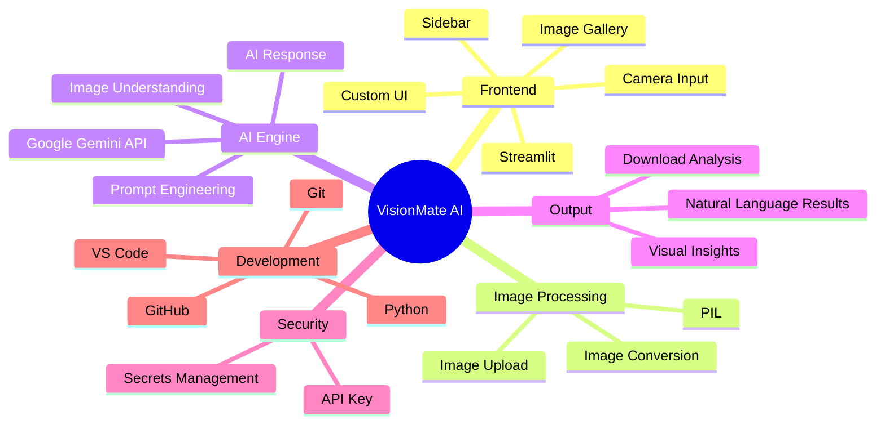
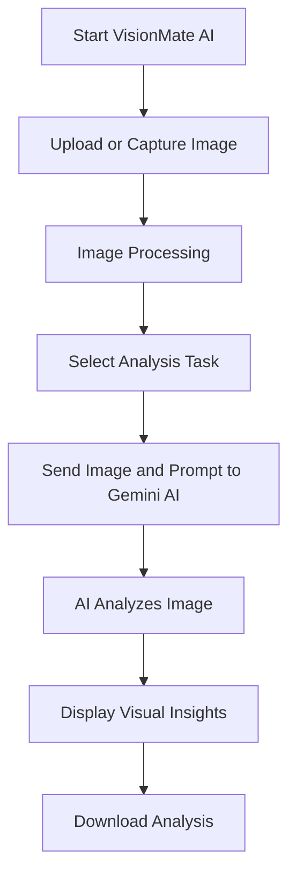

# 👁️ VisionMate AI

**AI-Powered Image Understanding & Visual Analysis**

VisionMate AI is an interactive computer vision application built with Python, Streamlit and Google's Gemini AI. It allows users to upload images and receive AI-generated visual insights through natural language.

## ✨ Features

- 🖼️ **Image Upload** – Upload images for AI analysis.
- 📸 **Camera Input** – Capture images for analysis.
- 🤖 **AI-Powered Analysis** – Understand image content using Gemini AI.
- 🔍 **Visual Understanding** – Extract meaningful information from images.
- 💬 **Natural Language Insights** – Get easy-to-understand AI responses.
- 📥 **Download Results** – Save generated analysis.
- 🎨 **Interactive UI** – Clean, responsive and user-friendly interface.

## 🧠 Project Mind Map



## 🔄 Project Workflow



## 🛠️ Tech Stack

| Technology | Purpose |
|---|---|
| Python | Core programming |
| Streamlit | Web application |
| Google Gemini API | AI image understanding |
| Pillow (PIL) | Image processing |
| Git & GitHub | Version control |

## 📁 Project Structure

```text
VisionMate-AI/
│
├── app.py
├── requirements.txt
├── README.md
├── ROADMAP.md
├── DAILY_PROGRESS.md
│
├── .streamlit/
│   └── secrets.toml
│
└── .gitignore
```

*Note: `secrets.toml` is kept locally and excluded from GitHub.*

## 🚀 Installation & Setup

**1. Clone the repository**

```bash
git clone https://github.com/21vicky/VisionMate-AI.git
```

**2. Open the project folder**

```bash
cd VisionMate-AI
```

**3. Create a virtual environment**

```bash
python -m venv venv
```

**4. Activate the environment (Windows)**

```bash
venv\Scripts\activate
```

**5. Install dependencies**

```bash
pip install -r requirements.txt
```

**6. Configure your Gemini API key**

Create `.streamlit/secrets.toml` and add:

```toml
GEMINI_API_KEY = "YOUR_GEMINI_API_KEY"
```

Never upload your API key to GitHub.

**7. Run the application**

```bash
streamlit run app.py
```

## 🎯 Project Objective

To explore practical applications of Artificial Intelligence and Computer Vision by building an interactive image-understanding platform using modern AI technologies.

## 📌 Project Status

**Under Development** 🚧

Upcoming improvements:
- More image-analysis capabilities
- Improved AI response handling
- Better error handling
- Additional visual intelligence features

## 👨‍💻 Developer

**Vignesh U**

- GitHub: [@21vicky](https://github.com/21vicky)
- Project Repository: [VisionMate AI](https://github.com/21vicky/VisionMate-AI)

---

⭐ If you find this project interesting, consider giving the repository a star!

**Built with curiosity, Python and AI.** 🚀