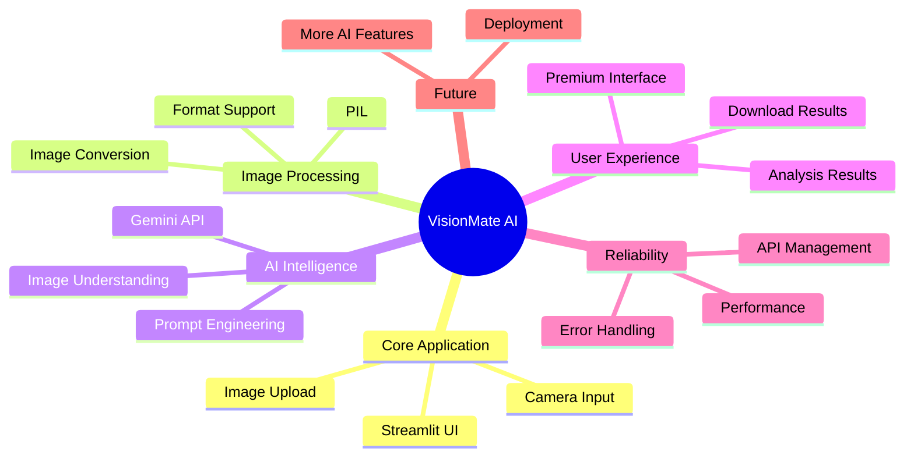

# 🗺️ VisionMate AI — Development Roadmap

\
   \<strong>From Image Upload to Intelligent Visual Understanding\</strong>   \    Building an AI-powered computer vision assistant with Python, Streamlit and Gemini. \

---

## 📊 Project Progress

| Milestone              | Status         |
| ---------------------- | -------------- |
| Project Setup          | ✅ Completed    |
| Streamlit UI           | ✅ Completed    |
| Gemini API Integration | 🟡 In Progress |
| Image Analysis         | 🟡 In Progress |
| Error Handling         | 🔜 Planned     |
| Deployment             | 🔜 Planned     |

---

## 🧠 Project Mind Map

---

## ✅ Phase 01 — Foundation

- [x] Initial project setup
- [x] Python environment configuration
- [x] Streamlit application structure
- [x] Requirements configuration
- [x] Custom application interface
- [x] GitHub repository setup

## ⚙️ Phase 02 — AI Integration

- [x] Gemini SDK integration
- [x] API key configuration
- [x] Image input preparation
- [ ] Successful end-to-end Gemini response
- [ ] Improve AI response quality
- [ ] Optimize image analysis prompts

## 🖼️ Phase 03 — Image Intelligence

- [x] Image upload functionality
- [x] Camera input support
- [ ] Support additional image formats
- [ ] Improve visual understanding
- [ ] Add specialized image-analysis tasks
- [ ] Improve analysis accuracy and usability

## 🎨 Phase 04 — User Experience

- [x] Custom premium UI
- [x] Responsive layout
- [x] Analysis result section
- [x] Download functionality
- [ ] Improve loading experience
- [ ] Add analysis history
- [ ] Enhance error messages

## 🚀 Phase 05 — Deployment

- [ ] Complete application testing
- [ ] Resolve API integration issues
- [ ] Prepare production configuration
- [ ] Deploy application
- [ ] Update documentation with live demo

---

## 🎯 Long-Term Vision

Transform VisionMate AI into an intelligent visual assistant that can:

- Understand and describe images.
- Extract useful information from visual content.
- Answer questions about uploaded images.
- Provide meaningful AI-generated insights.
- Deliver a smooth and accessible user experience.

---

## 🛠️ Technology Stack

| Technology        | Role                           |
| ----------------- | ------------------------------ |
| Python            | Core development               |
| Streamlit         | Interactive web interface      |
| Google Gemini API | AI-powered image understanding |
| Pillow (PIL)      | Image processing               |
| Git & GitHub      | Version control                |

---

## 📌 Current Project Status

**Development Stage:** AI Integration & Testing

**Next Milestone:** Successfully complete end-to-end image analysis with Gemini AI.

---

## 👨‍💻 Developer

**Vignesh U**

GitHub: [@21vicky](https://github.com/21vicky)

Project: [VisionMate AI](https://github.com/21vicky/VisionMate-AI)

---

\

&#x20; \<strong>Building intelligent experiences, one image at a time. 👁️\</strong>
\

